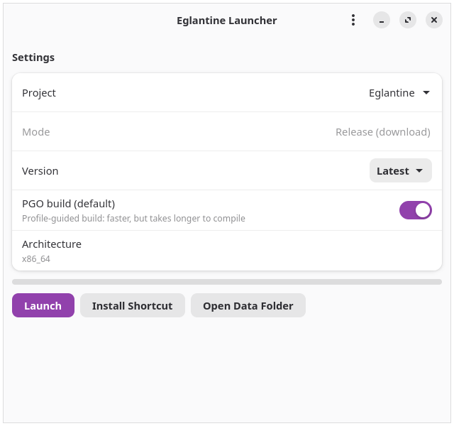
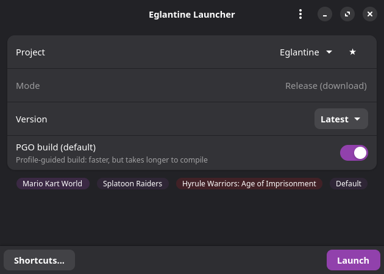

# Eglantine Launcher


A small libadwaita launcher for [Eglantine](https://github.com/Djihads80/Eglantine)
and community forks such as [PokeDinner](https://git.eden-emu.dev/Franseven/PokeDinner-a-Eglantine-Fork).

<table>
  <tr>
    <td></td>
    <td></td>
  </tr>
</table>

[More screenshots →](docs/screenshots/)

## Features

- Track multiple emulator sources (Eglantine, PokeDinner, or add your own fork)
- Download release builds (Linux AppImage for x86_64/aarch64, Windows zip)
- Choose PGO (default) or non-PGO builds
- Pick a specific release, or "Latest" (auto-skips releases with no build for your platform)
- Build from source at a specific commit, or "Latest"
- Per-source options: include pre-releases, exclude keyword filter (e.g. hides AMD experimental builds on Nvidia systems by default)
- Checks for updated releases or new commits before launching
- Dependency check at startup with a copyable report; can hide source builds until deps are sorted
- Install a desktop shortcut for one-click launching (`--auto`)
- Self-update notification when a new launcher release exists
- Minimizes on game launch and hides to the tray on close if you like
  (asks the first time; change it in Settings)

## Run

```sh
python3 -m eglantine_launcher
```

Auto mode (used by the shortcut — checks, downloads/builds if needed, launches):

```sh
python3 -m eglantine_launcher --auto
```

## Adding a source

Settings (top-right menu) → Add. Paste a GitHub or Forgejo repo link and the
launcher fills in the name, branch list, and releases feed automatically.
Pick the branch, then Save.

Click the globe icon on a source to open its repo. Sources with only Windows
builds automatically offer build-from-source only on Linux.

## GitHub API token (optional)

GitHub allows ~60 API requests/hour per IP without a token, which release
checks can exhaust. A token raises that to 5,000/hour. Add one in Settings —
it only needs public-repo read access (the default), and it never leaves your
machine (`~/.config/eglantine-launcher/config.json`). The Settings page links
to a pre-filled token creation page (name + no expiration).

## Building from source

Linux: cmake, ninja, git, a C++ compiler, pkg-config, and Qt 6 dev files
(the launcher bundles FFmpeg/SDL3 itself). Windows: see
[docs/build-windows.md](docs/build-windows.md) for the full setup
(Visual Studio C++ workload, CMake, Git, Python, Vulkan SDK, Qt).

With PGO enabled (default), Linux source builds additionally use clang and
the Eden PGO profile when available (prefers `~/opt/llvm23`, else system
`clang++`; the profile is verified readable before use and downloads to
`~/.cache`). If no usable clang/profile is found the launcher says so and
does a regular build instead. PGO compiles are capped at 6 jobs to avoid
running out of RAM.

## Install shortcut

Use the "Install Shortcut" button in the app, or run:

```sh
python3 -m eglantine_launcher  # then click Install Shortcut
```

## Requirements

- Python 3.10+
- GTK 4 + libadwaita (PyGObject)

## Downloads

Tagged releases ship a Windows PyInstaller build plus Linux
AppImage, .deb, .rpm, and Flatpak (see `.github/workflows/release.yml`).
The AppImage needs Python 3.10+, GTK 4, and libadwaita on the host.
