# Screenshots

| | Light | Dark |
|---|---|---|
| Main | 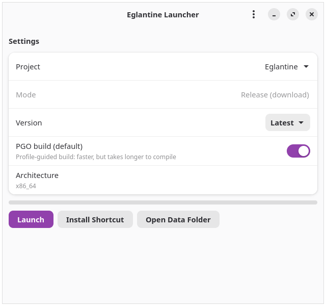 | 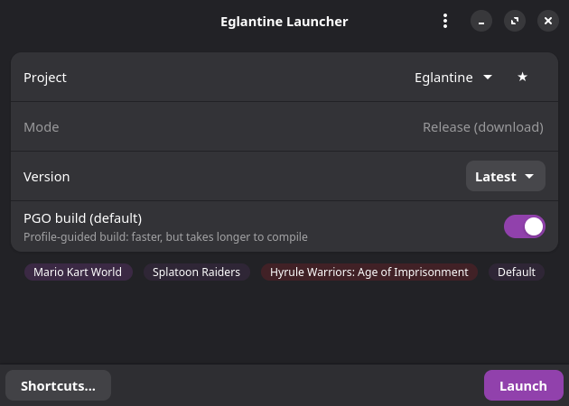 |
| Settings | 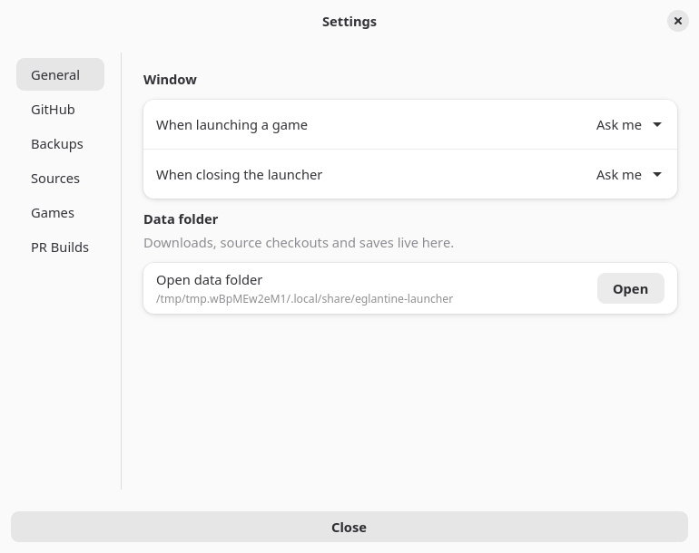 | 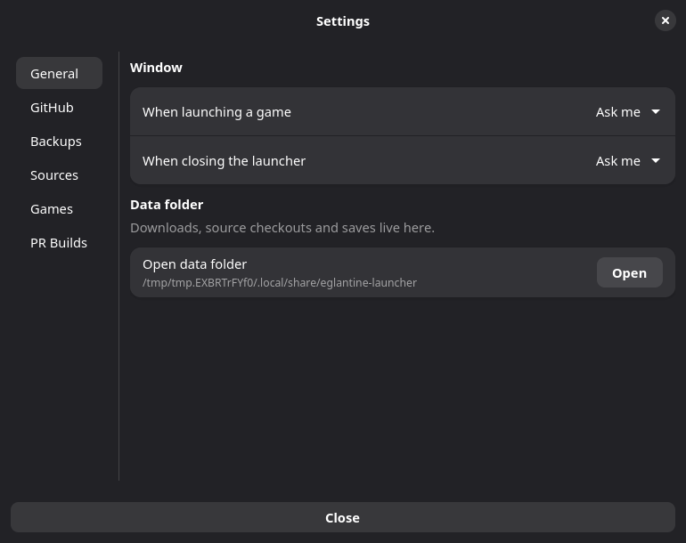 |
| Settings sources | 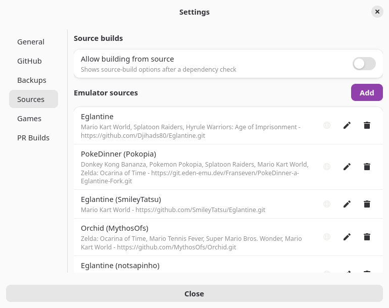 | 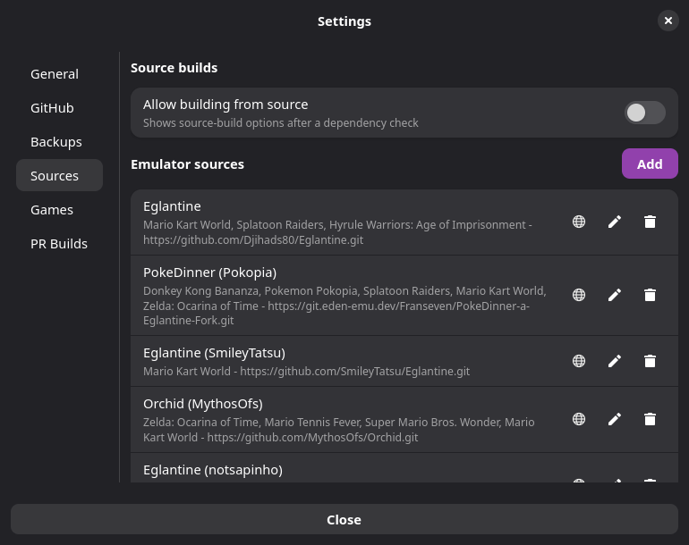 |
| Settings games | 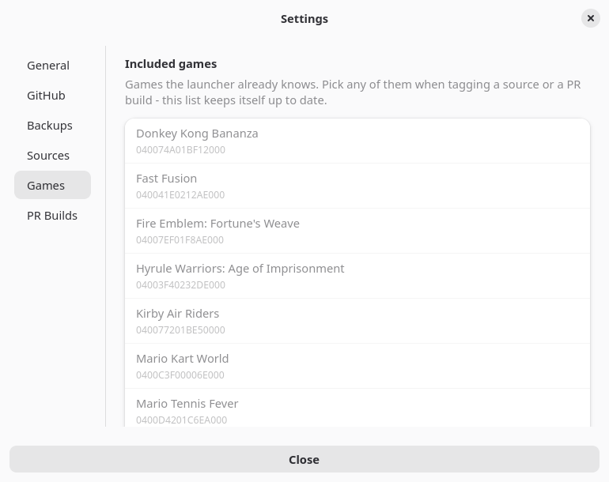 | 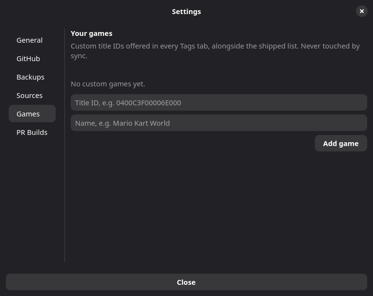 |
| Settings PR builds | 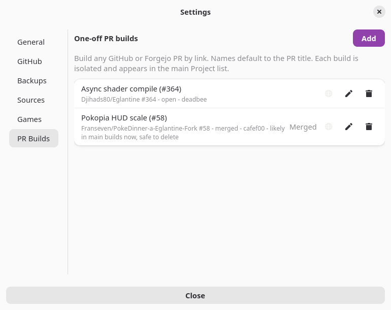 | 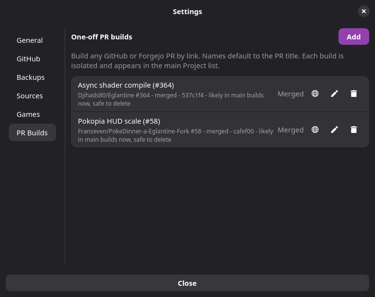 |
| Source settings | 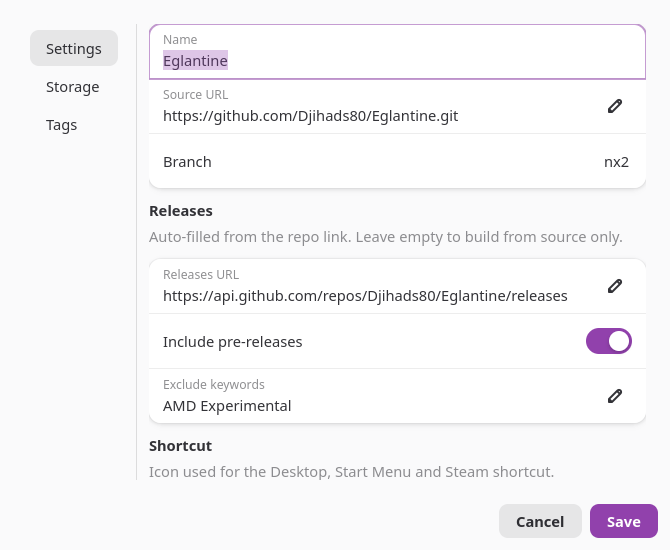 | 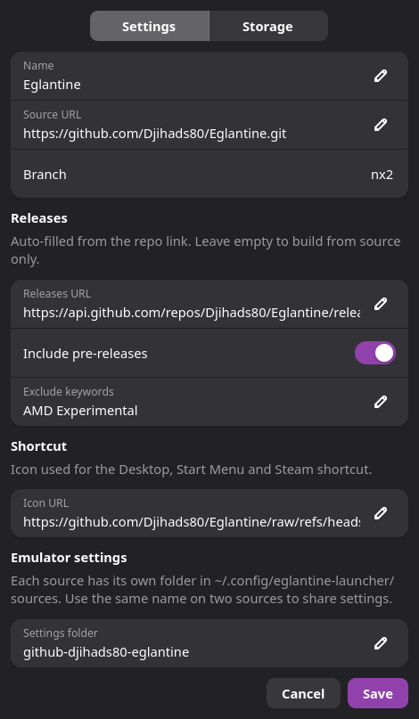 |
| Source storage | 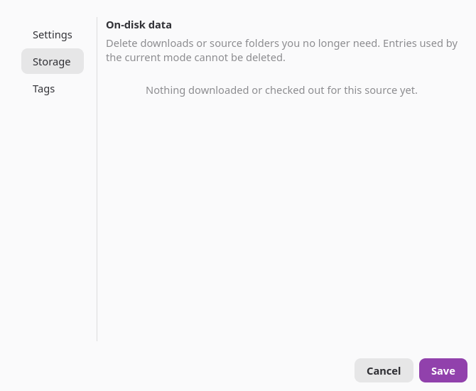 | 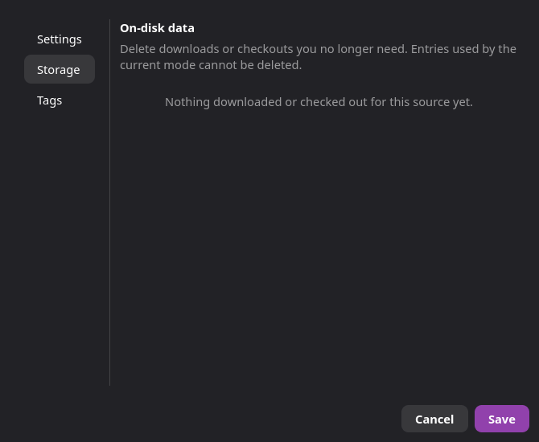 |
| Source tags | 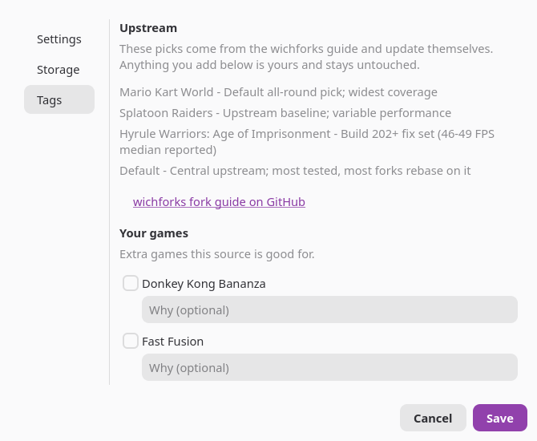 | 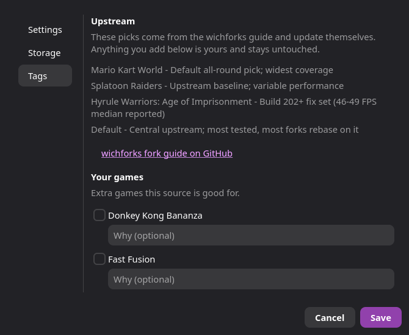 |
| About | 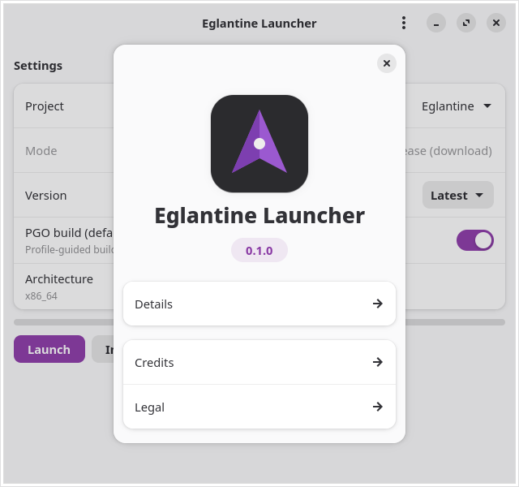 | 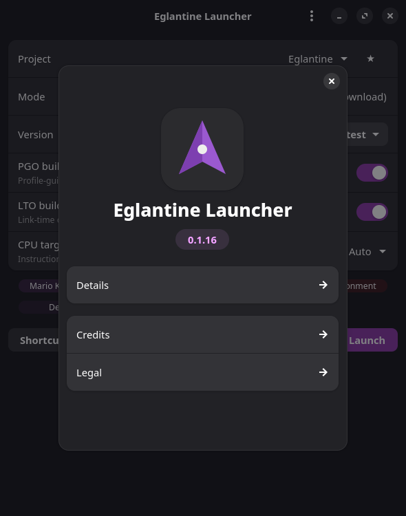 |
| PR Builds | 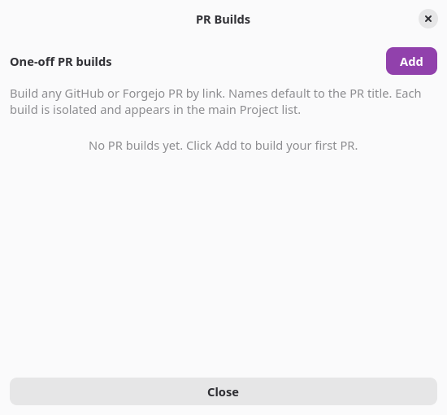 | 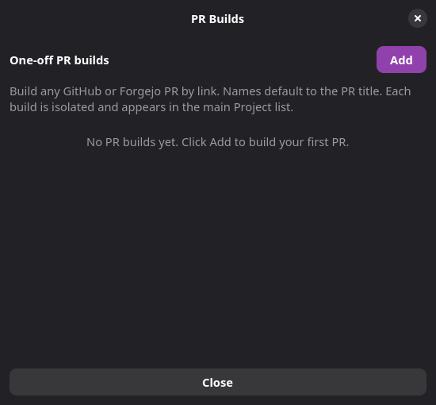 |

Retake with `make screenshot` (needs Xvfb, xdotool, ImageMagick).
Captures run with an isolated home directory, so only the shipped
defaults appear — never personal config. The PR Builds shot seeds two
example entries so the list UI is visible.
